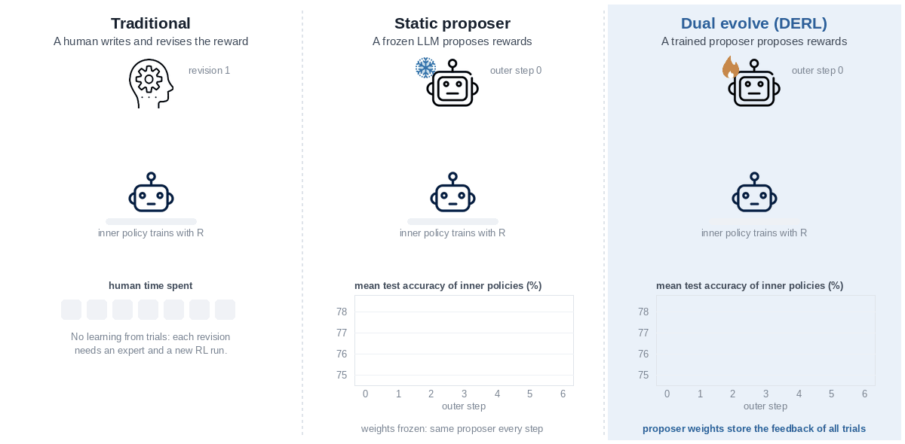
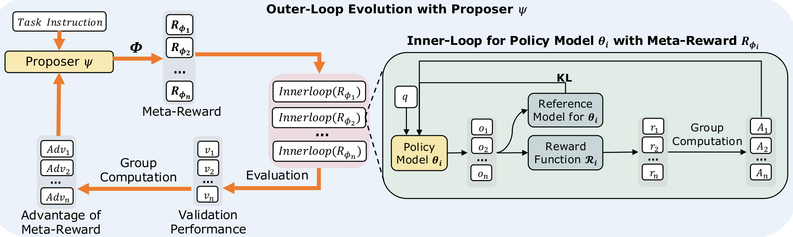
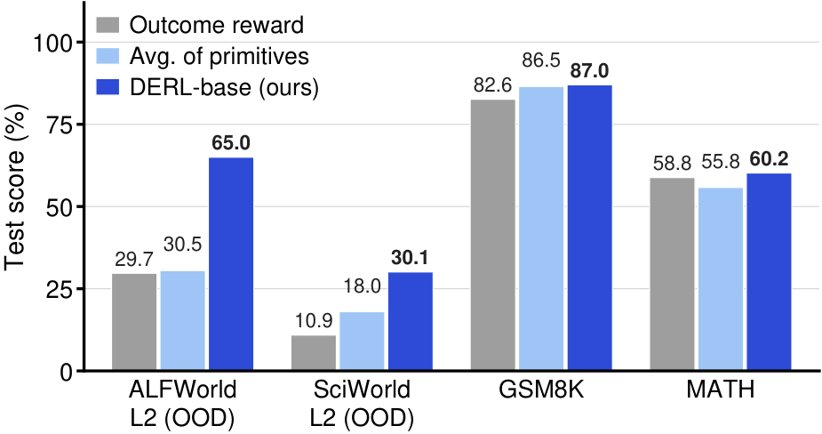

<div align="center">

<h1>DERL: Dual-Evolving Reinforcement Learning<br>for Automated Reward Design</h1>

<p>
<a href="https://sitaocheng.github.io/derl/"></a>
<a href="https://arxiv.org/abs/2512.13399"></a>
<a href="https://huggingface.co/DifferentiableEvolutionaryRL"></a>
<a href="LICENSE"></a>
</p>

<p>
<a href="#overview">Overview</a> &nbsp;·&nbsp;
<a href="#quick-start">Quick start</a> &nbsp;·&nbsp;
<a href="#file-descriptions">File descriptions</a> &nbsp;·&nbsp;
<a href="#citation">Citation</a>
</p>

</div>

---

DERL tunes the reward proposer itself with its trials and their scores.
A small proposer composes a reward from task primitives, an inner policy trains with that reward, and the inner policy's validation score updates the proposer by policy gradient.
The project page has the full results and an interactive analysis: **https://sitaocheng.github.io/derl/**

This repository contains the code for the paper.
It is built on [veRL](https://github.com/volcengine/verl) and uses GRPO in both loops.
We implement the training loop that couples the two loops.
The outer-loop group-relative advantage and the inner-loop training are adapted from the veRL code.

## Overview

<p align="center">
  
</p>

Three ways to design a reward.
A human revises the reward after every RL run.
A static proposer (a frozen LLM) reads earlier scores in its prompt, but its weights never change.
In DERL, every validation score updates the proposer by policy gradient.
The curves are the mean GSM8K test accuracy of the inner policies trained from each outer step's proposals, and the reward programs in the animation are illustrative.

<p align="center">
  
</p>

The proposer reads a fixed task instruction and samples *n* reward programs.
Each program trains one inner policy with GRPO, and the policy's validation score is the reward of that program.
The group-normalized scores update the proposer with GRPO.

<p align="center">
  
</p>

## Quick start

1. Clone the repository.
   ```bash
   git clone https://github.com/sitaocheng/DERL
   cd DERL
   ```
2. Install the dependencies.
   ```bash
   pip install -r requirements.txt
   ```
3. Set the paths and settings in `grpo_coordinator.py` and `run_qwen2_5_3b_llm_math_meta_llm_rl.sh` for your environment.
4. Download the base model for the inner-loop policy (for example, `Qwen/Qwen2.5-3B`) and set `model_path` in the script.
5. Download the initial outer-loop proposer from our [Hugging Face organization](https://huggingface.co/DifferentiableEvolutionaryRL) and set `INITIAL_MODEL_PATH` in `grpo_coordinator.py`.
6. Put your training, validation and test data in `./dataset/` and set the data paths in `eval_vllm.py`. The scripts in `./examples/data_preprocess` are a good starting point.
7. Define your primitives in `./verl/utils/reward_score/meta_reward_grpo.py` and set the dataset information in `./verl/utils/reward_score/__init__.py`.
8. Run the coordinator.
   ```bash
   python grpo_coordinator.py
   ```

## File descriptions

| File | Role |
|---|---|
| `grpo_coordinator.py` | Coordinates the outer and inner loops for DERL-base. |
| `grpo_coordinator_population.py` | Coordinates the outer and inner loops for the round-based variant (DERL-pop in the code, DERL-full on the project page). |
| `eval_vllm.py`, `eval.sh` | Evaluate validation and test performance with vLLM (`eval.sh` is called by the coordinator). |
| `constrained_rollout.py` | Generates reward programs with constrained decoding. |
| `expression_check.py` | Checks that a generated reward program is a valid arithmetic expression. |
| `verl/utils/reward_score/meta_reward_grpo.py` | Defines the primitives. |
| `verl/utils/reward_score/__init__.py` | Applies the generated reward (`custom_fn`). |
| `verl/trainer/ppo/ray_trainer.py` | Outer-loop GRPO update (`fit_outer()`). |
| `examples/grpo_trainer/run_qwen2_5_3b_llm_math_meta_llm_rl.sh` | Inner-loop training script. |
| `examples/grpo_trainer/run_qwen2_5_3b_llm_math_meta_llm_rl_population.sh` | Inner-loop training script for the round-based variant. |
| `examples/grpo_trainer/run_qwen2_5_05b_instr_math_meta_rl.sh` | Outer-loop training script. |

## Citation

If you find this repository useful, please cite our paper:

```bibtex
@misc{cheng2025differentiableevolutionaryreinforcementlearning,
      title={Differentiable Evolutionary Reinforcement Learning},
      author={Sitao Cheng and Tianle Li and Xuhan Huang and Xunjian Yin and Difan Zou},
      year={2025},
      eprint={2512.13399},
      archivePrefix={arXiv},
      primaryClass={cs.AI},
      url={https://arxiv.org/abs/2512.13399},
}
```
